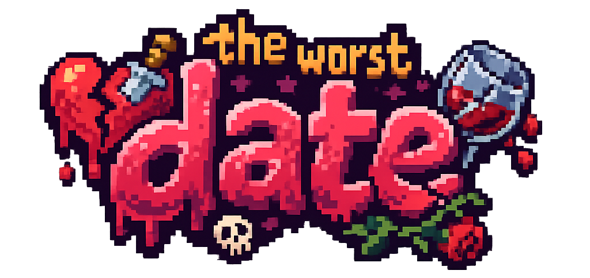
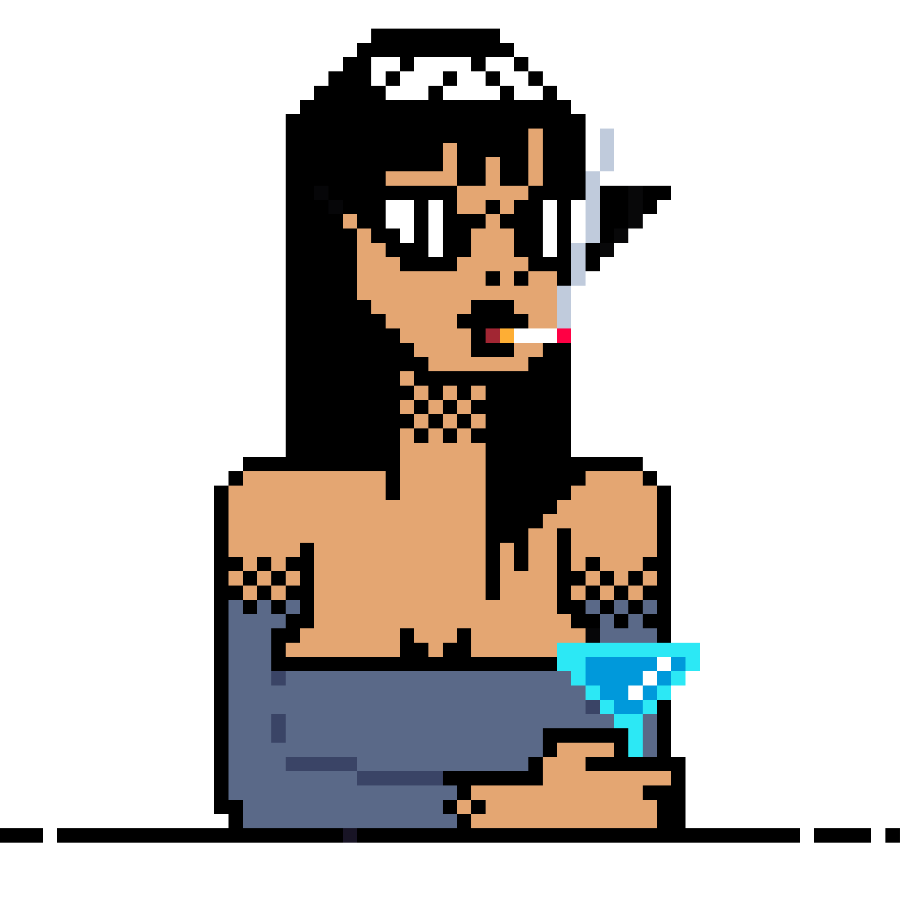
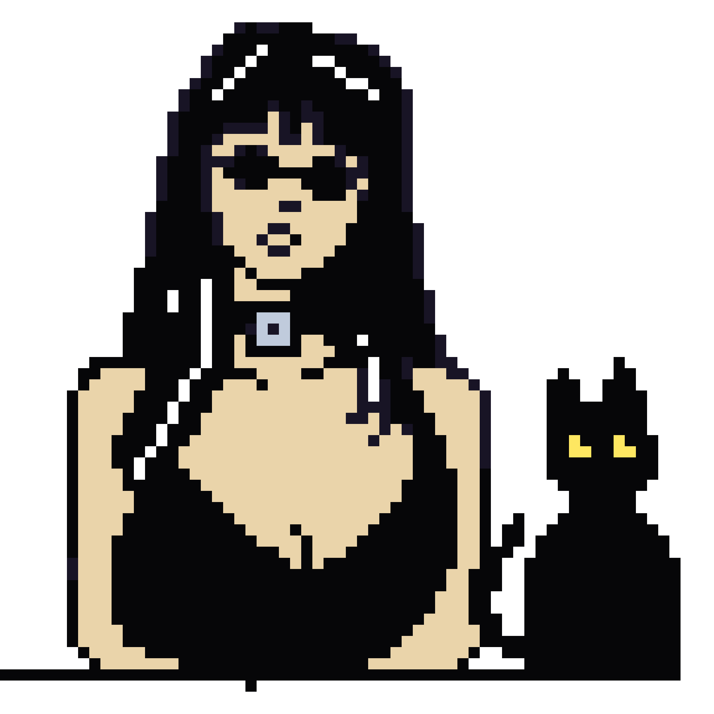

<div align="center">



# 💔 THE WORST DATE 💔

**Il primo appuntamento che non vorresti mai avere... ma a cui non sai dire di no.**

`▶ PRESS START TO FLIRT`

</div>

---

## 🕹️ Di cosa si tratta?

Hai un match. Lei è lì, al bancone, pixel dopo pixel, e ti guarda.
Hai **5 domande** per dimostrarle che vali qualcosa. Sbagli? Il cuore resta vuoto. E lei se ne ricorderà.

**The Worst Date** è un quiz in stile dating-sim anni '90: grafica pixel art, font retrò, cuori da riempire e zero pietà per chi non sa la differenza tra un Negroni e uno Spritz.

> ⚠️ _Nessun cuore è stato spezzato davvero durante lo sviluppo di questo gioco. Forse._

---

## 💘 Scegli il tuo match

<table align="center">
  <tr>
    <td align="center"></td>
    <td align="center"></td>
    <td align="center"></td>
  </tr>
  <tr>
    <td align="center"><b>EMMA</b></td>
    <td align="center"><b>LISA</b></td>
    <td align="center"><b>ANNA</b></td>
  </tr>
  <tr>
    <td align="center">📸 Red carpet, aperitivi esclusivi e follower.<br/><i>Se non è su Instagram, non è mai successo.</i></td>
    <td align="center">🦇 Horror, ombre e poesia gotica.<br/><i>La luce del sole? No grazie.</i></td>
    <td align="center">📚 Libri, musei e conversazioni brillanti.<br/><i>Il cervello è la sua love language.</i></td>
  </tr>
  <tr>
    <td align="center">Difficoltà: 💅💅💅</td>
    <td align="center">Difficoltà: 🕯️🕯️🕯️</td>
    <td align="center">Difficoltà: 🧠🧠🧠</td>
  </tr>
</table>

---

## 🎮 Come si gioca

1. **Premi "Gioca"** e prepara il tuo miglior sorriso.
2. **Scegli il tuo match** tra Emma, Lisa e Anna.
3. **Ascolta la sua presentazione** e rispondi con un timido _"Senti, ma..."_
4. **Rispondi a 5 domande** pescate a caso dalle sue passioni. Ogni partita è diversa!
5. **Riempi i cuori** ❤️ ogni risposta giusta accende un cuore, ogni errore lo lascia vuoto 🖤
6. **Scopri il verdetto**:

| Cuori ❤️ | Esito                                                    |
| :------: | :------------------------------------------------------- |
|  0 – 2   | 🚪 _"Sparisci!"_ (e ha già chiamato il taxi)             |
|  3 – 5   | 🔥 Hai fatto colpo... la sua frase finale è tutta per te |

7. Non è andata bene? **Puoi riprovarci** 🔥😉💋 tanto lei non ricorda niente.

---

## 🛠️ Tecnologie usate

Niente framework, niente scuse: solo i grandi classici.


- **HTML** per la struttura delle pagine
- **CSS** per lo stile pixel art, con il font [Press Start 2P](https://fonts.google.com/specimen/Press+Start+2P) e layout responsive
- **JavaScript vanilla** per la logica: estrazione casuale delle domande, ordine casuale delle risposte, punteggio e cambio di schermata dinamico

---

## 🚀 Avviare il gioco in locale

```bash
# 1. Clona la repository
git clone https://github.com/cafagnarob/quiz_game.git

# 2. Entra nella cartella
cd quiz_game

# 3. Apri index.html nel browser
#    (consigliato: estensione Live Server di VS Code)
```

Fatto. Lei ti sta già aspettando. 💌

---

## 📁 Struttura del progetto

```
quiz_game/
├── index.html        → schermata iniziale (logo + "Gioca")
├── gamepage.html     → selezione del match e partita
├── script.js         → logica di gioco e domande delle ragazze
├── style.css         → stile pixel art e responsive
├── Girls1/           → gif e immagini dei personaggi
└── assets/
    └── images/       → cuori, sfondi e decorazioni
```

---

## 👾 Il team

Quattro sviluppatori, un solo obiettivo: rovinarti la serata.

| Player                 | GitHub                                       |
| :--------------------- | :------------------------------------------- |
| 🎮 **Roberto Cafagna** | [@cafagnarob](https://github.com/cafagnarob) |
| 🎮 **Andrea Saderi**   |                                              |
| 🎮 **Paolo**           | [@PaoloF16](https://github.com/PaoloF16)     |
| 🎮 **Vincenzo Mola**   |                                              |

Progetto realizzato durante il Master Full-Stack di **Epicode**.

---

<div align="center">

**GAME OVER?** 🖤🖤🖤🖤🖤

_Insert coin to try again_ 🪙

</div>
